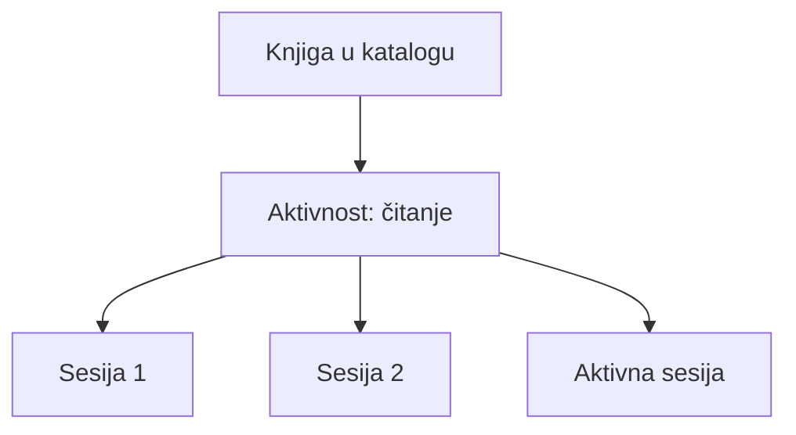
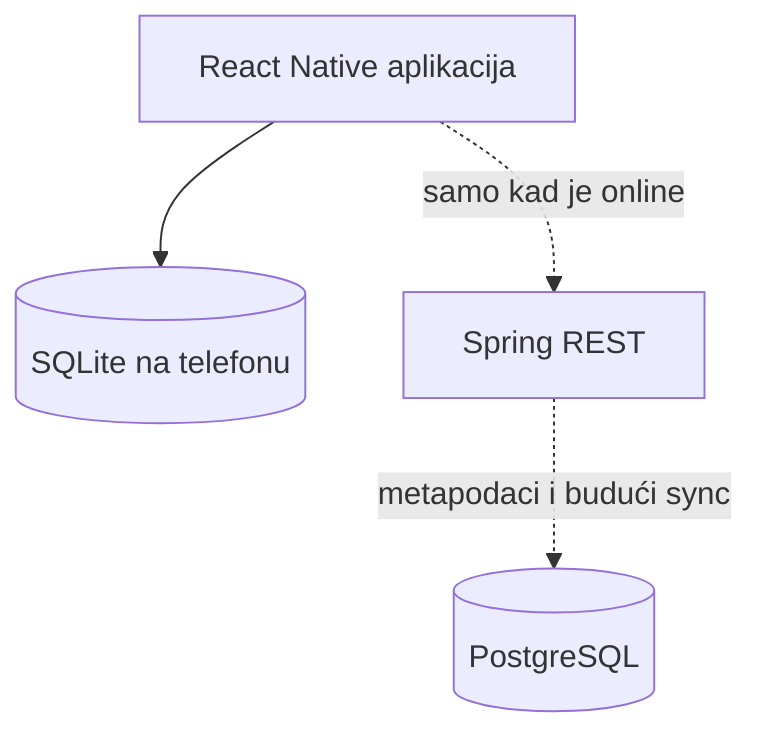

.\start-backend.ps1
npm run web:clear


## Podaci o projektu
- Student: Leon Strakoš
- Projekt: Sustav za upravljanje knjigama u knjižnici
- Tehnologije: React Native, Expo SQLite, Spring Boot i PostgreSQL
- Akademska godina: 2025./2026.

# Osobni katalog i praćenje vremena

Projekt je sada **offline-first**: React Native aplikacija sprema osobne podatke u
SQLite bazu na telefonu. Spring Boot i PostgreSQL ostaju u projektu kao neobavezna
osnova za online metapodatke te budući backup i sinkronizaciju.
Postojeći katalog knjiga ostaje funkcionalna osnova, a aplikacija se postupno razvija u
osobni katalog medija, interesa, aktivnosti i vremena.

## Trenutačna razvojna etapa: osobni katalog života

Aplikacija sada povezuje osobni katalog, teme, aktivnosti, trajno spremljeno vrijeme i
zapise u jednu modularnu cjelinu:

- knjige imaju osobni status čitanja, napredak, doživljaj, favorite i datume;
- početni ekran **Danas** prikazuje aktivne timere i današnji zbroj vremena;
- početni ekran ispod aktivnog timera prikazuje **Nedavno / Continue** za pauzirane
  aktivnosti poredane po zadnjem korištenju;
- zajednički **Katalog** objedinjuje Knjige, Filmove i serije te Igre; dodavanje i
  online pretraga nalaze se unutar odgovarajuće zbirke, bez duplih prečaca na početnom
  ekranu;
- **tema** okuplja vlastite aktivnosti, primjerice igranje i proučavanje šaha;
- **aktivnost** predstavlja radnju koja se može nastaviti, primjerice `Čitanje — Dina`;
- **vremenska sesija** predstavlja jedan stvarni interval s vremenom početka i završetka;
- ekran **Povijest** prikazuje spremljene sesije kronološki i podržava paginaciju;
- aplikacija podržava bilješke, citate, opažanja, recenzije i zapise napretka povezane s
  knjigom, temom ili aktivnosti;
- igre imaju vlastiti katalog, statuse, platformu, napredak, doživljaj, favorite,
  timer igranja i online pretragu bez obveznog API ključa;
- filmovi i serije imaju osobne statuse gledanja, napredak, favorite, doživljaj,
  timer gledanja i online pretragu bez obveznog API ključa;
- knjige se mogu pronaći i uvesti iz Open Libraryja i Google Booksa uz pregled
  duplikata i izričitu potvrdu prije promjene bibliografskih podataka;
- ekran **Zapisi** omogućuje izradu, uređivanje, filtriranje i brisanje bilješki,
  citata, opažanja, recenzija i zapisa napretka.

Pravila mjerenja vremena:

- Pokretanje timera sprema `startedAt` u SQLite na telefonu; aplikacija ne zapisuje
  trajanje svake sekunde.
- Aktivni timer zato preživljava ponovno učitavanje, zatvaranje aplikacije i mirovanje
  telefona.
- Zaustavljanje trajno zaključuje sesiju, a detalj knjige prikazuje zbroj svih sesija.
- Jedna aktivnost ne može imati dvije aktivne sesije, ali različite aktivnosti mogu se
  pratiti istodobno.
- Brisanje knjige ne briše već spremljene vremenske sesije.
- Gašenje računala, gubitak interneta ili zatvaranje aplikacije ne prekida lokalni katalog.



## Arhitektura



Knjige, igre, filmovi/serije, teme, aktivnosti, sesije, statistika i zapisi čitaju se i
pišu izravno u lokalnu bazu `life_catalogue.db`. Postojeći mobilni DTO ugovori ostaju
isti, pa ekrani ne ovise o tome je li Spring servis pokrenut.

## Korištene tehnologije

- mobilna aplikacija: React Native, Expo SDK 54, Expo SQLite, TypeScript i React Navigation
- backend: Java 17, Spring Boot 3.5, Spring Web, Spring Data JPA i Bean Validation
- glavna mobilna baza: SQLite na Android/iOS uređaju
- neobavezna poslužiteljska baza: PostgreSQL 17 i Flyway migracije
- razvojno okruženje: Docker Compose, Maven i npm

## Struktura projekta

```text
library-management-system/
├── backend/                 Spring Boot aplikacija
│   ├── src/main/java/       kontroler, servis, mapper, repozitorij i entiteti
│   ├── src/main/resources/  konfiguracija i Flyway migracije
│   └── src/test/            integracijski testovi REST API-ja
├── mobile/                  Expo/React Native aplikacija
│   └── src/                 ekrani, komponente, API servis i tipovi
├── docs/                    Postman kolekcija
└── docker-compose.yml       PostgreSQL i backend
```


## 1. Offline spremanje na telefonu

Pri prvom pokretanju aplikacija automatski izrađuje `life_catalogue.db` u privatnom
prostoru aplikacije. Baza ostaje spremljena nakon zatvaranja i ponovnog pokretanja
aplikacije. U njoj su katalog, teme, aktivnosti, timeri, povijest i zapisi.

Važno: brisanje aplikacije ili brisanje njezinih podataka u postavkama telefona briše i
lokalnu bazu. Izvoz/backup i sinkronizacija s PostgreSQL-om predviđeni su kao sljedeća
etapa; trenutačno nisu automatski uključeni.

## 2. Svakodnevni razvoj i testiranje u webu

Dok se aplikacija razvija, nije potrebno stalno raditi Android build. Preduvjeti su samo
Node.js i npm. Iz korijena projekta pokrenite:

```powershell
.\start-mobile.ps1
```

Skripta instalira ovisnosti samo pri prvom pokretanju, provjerava TypeScript i otvara
web-verziju, najčešće na `http://localhost:8081`. Promjene koda osvježavaju se bez novog
Android builda.

Ručno pokretanje:

```bash
cd mobile
npm ci
npm run typecheck
npm run web
```

Ako Metro nakon promjene konfiguracije zadrži stari cache, jednokratno pokrenite
`npm run web:clear`.

Web koristi isti lokalni API sloj i istu SQLite shemu kao mobilna verzija. Podaci ostaju
u spremištu tog browsera nakon refreshanja i ponovnog pokretanja. Brisanje podataka
stranice ili korištenje privatnog prozora briše/izolira razvojnu bazu.

Važno: razvojna baza browsera i buduća baza instalirane aplikacije na telefonu dva su
odvojena lokalna spremišta. Prije završnog builda dodat ćemo izvoz/uvoz ili sync ako
želite prenijeti testne podatke na telefon. `EXPO_PUBLIC_API_URL` nije potreban za
lokalni CRUD, timere, povijest ili statistiku.

Expo SQLite web koristi WebAssembly; `mobile/metro.config.js` uključuje WASM datoteke i
potrebne razvojne COOP/COEP headere.

## 3. Završni build za telefon

Za stvarni uvjet **telefon radi dok je računalo ugašeno**, jednom izradite i instalirajte
samostalni Android/iOS build. Primjer internog Android builda:

```bash
cd mobile
npx eas build --platform android --profile preview
```

Nakon instalacije tog builda računalo i internet nisu potrebni za osobni katalog,
timere ni povijest. Internet je potreban samo kada svjesno pokrenete online pretragu
metapodataka.

## 4. Neobavezni backend i PostgreSQL

Backend nije potreban za osnovni rad aplikacije. Trenutačno je koristan za online
pretrage Open Library/Google Books, Apple kataloga filmova, TVmaze serija i Steam
Storea, a kasnije se može koristiti za sinkronizaciju i backup.

### Preporučeno na Windowsu

Iz korijena projekta pokrenite skriptu koja uvijek bira ispravnu bazu
`life_catalogue_v2` i uklanja naslijeđene Flyway override varijable:

```powershell
.\start-backend.ps1
```

Skripta koristi vlastitu lokaciju projekta, pa radi i kada je ZIP raspakiran u dodatnu
mapu `TRACKING APP`. Za drugačiju lokalnu lozinku postavite
`LIFE_CATALOGUE_DB_PASSWORD` prije pokretanja backenda.

### Najjednostavnije: Docker Compose
```bash
docker compose up --build
```
Time se pokreću PostgreSQL na portu `5432` i backend na adresi:
```text
http://localhost:8080/api/books
```

### Lokalno pokretanje bez Docker backenda
Za lokalno pokretanje bez Dockera potrebno je prethodno izraditi PostgreSQL korisnika i bazu:

bash
``` 
cd backend
```

```
CREATE ROLE library_user
WITH LOGIN PASSWORD 'library_password';
```
Zatim se zasebno izrađuje baza:
```
CREATE DATABASE life_catalogue_v2
WITH OWNER = library_user;
```
ili

```
$env:DB_URL = "jdbc:postgresql://localhost:5432/life_catalogue_v2"
$env:DB_USERNAME = "library_user"
$env:DB_PASSWORD = "library_password"
```


Na praznoj bazi dovoljno je pokrenuti backend:
Pokrenite samo PostgreSQL, a zatim u novom terminalu:

```bash
mvn spring-boot:run
```

Zadane postavke veze su u `backend/src/main/resources/application.yml`. Mogu se promijeniti varijablama `DB_URL`, `DB_USERNAME` i `DB_PASSWORD`.


- `V1__create_books_table.sql` izrađuje tablicu `books` i potrebne indekse
- `V2__seed_books.sql` dodaje tri početne knjige
- `V3__seed_catalog.sql` dodaje još 100 demo-knjiga
- `V4__create_activities_and_time_sessions.sql` dodaje trajne aktivnosti i sesije
- `V5__add_personal_book_tracking.sql` dodaje osobni status, napredak i doživljaj knjige
- `V6__create_topics_and_link_activities.sql` dodaje teme i vlastite kategorije aktivnosti
- `V7__create_entries.sql` dodaje bilješke, citate, opažanja, recenzije i napredak
- `V8__create_games.sql` dodaje katalog igara i veze s aktivnostima igranja
- `V9__create_media_catalog.sql` dodaje filmove, serije i aktivnosti gledanja

Migracije su nepromjenjiva povijest baze: nakon što je broj migracije jednom primijenjen,
njegova se datoteka više ne mijenja niti ponovno koristi. Svaka buduća promjena dobiva
novi broj (`V10`, `V11` itd.). Ne pokrećite `flyway repair` radi prikrivanja checksum
neslaganja. Tracking App koristi isključivo bazu `life_catalogue_v2`; baza projekta Bell
ne smije se koristiti za ovu aplikaciju.

### Neobavezne poslužiteljske API postavke

Vanjski izvori služe samo za metapodatke. Osobni statusi, napredak, doživljaj, favoriti,
zapisi i vrijeme uvijek ostaju u SQLite bazi na telefonu.

```powershell
$env:GOOGLE_BOOKS_API_KEY = "neobavezni-google-books-kljuc"
$env:IGDB_CLIENT_ID = "twitch-client-id"
$env:IGDB_ACCESS_TOKEN = "twitch-app-access-token"
$env:TMDB_API_TOKEN = "tmdb-api-read-access-token"
```

Te varijable više nisu potrebne za online pretragu. Bez njih backend automatski koristi
Open Library za knjige, Apple Search za filmove, TVmaze za serije te Steam Store za
igre. Ako se ključevi jednom dodaju, TMDB i IGDB postaju primarni izvori, a javni
izvori ostaju automatski fallback. Tajne se nikad ne šalju mobilnoj aplikaciji.


### Online pretraga na fizičkom telefonu

Samo ako želite koristiti online metapodatke kroz postojeći backend, u datoteci
`mobile/.env` postavite IP adresu računala na kojem je backend pokrenut:

```env
EXPO_PUBLIC_API_URL=http://IP_ADRESA_RACUNALA:8080/api
```

Telefon i računalo tada moraju biti na istoj mreži. Ako backend nije dostupan, aplikacija
prikazuje poruku samo na ekranu online pretrage; lokalni podaci i timeri nastavljaju raditi.

### Neobavezna adresa backenda prema okruženju

| Okruženje | `EXPO_PUBLIC_API_URL` |
|---|---|
| Web-preglednik na računalu | `http://localhost:8080/api` |
| Android emulator | `http://10.0.2.2:8080/api` |
| iOS simulator | `http://localhost:8080/api` |
| Fizički Android/iOS uređaj | `http://IP_ADRESA_RACUNALA:8080/api` |

Nakon svake promjene `.env` datoteke potrebno je ponovno pokrenuti Expo.


## REST API

| Metoda | Putanja | Opis | Odgovor |
|---|---|---|---|
| `GET` | `/api/books` | dohvat svih knjiga | `BookResponse[]` |
| `GET` | `/api/books?page=0&size=10` | paginirani dohvat | `PagedResponse<BookResponse>` |
| `GET` | `/api/books/{bookId}` | dohvat jedne knjige | `BookResponse` |
| `POST` | `/api/books` | dodavanje knjige | `201 Created` + `BookResponse` |
| `PUT` | `/api/books/{bookId}` | uređivanje knjige | `BookResponse` |
| `DELETE` | `/api/books/{bookId}` | brisanje knjige | `204 No Content` |

`BookRequest` i `BookResponse` koriste `readingStatus`, `progress`, `enjoyment`,
`favourite`, `startedOn` i `finishedOn`. Staro javno polje `available` više nije dio
osobnog kataloga. Ako stariji klijent izostavi nova polja, backend primjenjuje sigurne
zadane vrijednosti `LATER`, `0` i `false`.

### API aktivnosti i sesija

| Metoda | Putanja | Opis |
|---|---|---|
| `GET` | `/api/activities/books/{bookId}/reading` | stanje i ukupno vrijeme čitanja knjige |
| `POST` | `/api/activities/books/{bookId}/reading/start` | pokretanje ili dohvat već aktivne sesije |
| `POST` | `/api/activities/books/{bookId}/reading/stop` | završetak i spremanje aktivne sesije |
| `GET` | `/api/activities/active` | svi trenutačno aktivni timeri |
| `GET` | `/api/activities/recent?limit=6` | zadnje pauzirane aktivnosti za brzi nastavak |
| `POST` | `/api/activities/{activityId}/start` | idempotentno pokretanje bilo koje aktivnosti |
| `POST` | `/api/activities/{activityId}/stop` | zaustavljanje aktivnosti iz globalnog prikaza |
| `GET` | `/api/activities/{activityId}/sessions` | povijest sesija jedne aktivnosti |

### API tema, statistike, povijesti i zapisa

| Metoda | Putanja | Opis |
|---|---|---|
| `GET` | `/api/topics` | sve teme |
| `GET` | `/api/topics/{topicId}` | jedna tema |
| `POST` | `/api/topics` | izrada teme |
| `PUT` | `/api/topics/{topicId}` | uređivanje teme |
| `DELETE` | `/api/topics/{topicId}` | brisanje teme bez brisanja povijesti |
| `GET` | `/api/topics/{topicId}/activities` | aktivnosti teme |
| `POST` | `/api/topics/{topicId}/activities` | nova aktivnost jedne od sedam podržanih kategorija |
| `GET` | `/api/stats/daily?date=YYYY-MM-DD&zone=Europe/Zagreb` | dnevni zbroj i raspodjela vremena |
| `GET` | `/api/history/sessions?page=0&size=30` | najnovije sesije s kontekstom knjige i teme |
| `GET` | `/api/entries` | zapisi s filtrima `bookId`, `topicId`, `activityId` i `type` |
| `GET` | `/api/entries/{entryId}` | jedan zapis |
| `POST` | `/api/entries` | novi zapis |
| `PUT` | `/api/entries/{entryId}` | uređivanje zapisa |
| `DELETE` | `/api/entries/{entryId}` | brisanje zapisa |

### API igara, filmova/serija i uvoza knjiga

| Metoda | Putanja | Opis |
|---|---|---|
| `GET/POST` | `/api/games` | popis/izrada igara |
| `GET/PUT/DELETE` | `/api/games/{gameId}` | detalj, izmjena ili brisanje igre |
| `GET/POST` | `/api/games/{gameId}/timer[/start\|/stop]` | stanje, početak ili završetak igranja |
| `GET` | `/api/games/metadata/search?query=...` | online pretraga igara (IGDB ili Steam fallback) |
| `GET/POST` | `/api/media` | popis/izrada filmova i serija |
| `GET/PUT/DELETE` | `/api/media/{mediaId}` | detalj, izmjena ili brisanje naslova |
| `GET/POST` | `/api/media/{mediaId}/watching[/start\|/stop]` | stanje, početak ili završetak gledanja |
| `GET` | `/api/media/tmdb/search?query=...&mediaType=MOVIE` | online pretraga filmova/serija (TMDB ili Apple fallback) |
| `GET` | `/api/book-metadata/search?q=...` | Open Library/Google Books pretraga |
| `GET` | `/api/book-metadata/isbn/{isbn}` | ISBN lookup i detekcija duplikata |
| `POST` | `/api/book-metadata/imports/preview` | pregled uvoza bez pisanja |
| `POST` | `/api/book-metadata/imports/confirm` | izričito potvrđen uvoz |

Potpuni ugovori novih modula nalaze se u `docs/BOOK_METADATA_API_CONTRACT.md`,
`docs/GAMES_API_CONTRACT.md` i `docs/MOVIES_TV_API_CONTRACT.md`.

Migracija `V4__create_activities_and_time_sessions.sql` dodaje tablice `activities` i
`time_sessions`, njihove indekse, veze i ograničenje jedne aktivne sesije po aktivnosti.

Točan oblik URL-a za paginaciju koristi query parametre `?`: `/api/books?page=0&size=10`.


Detaljna mapa modula i sljedećih etapa nalazi se u
`docs/LIFE_CATALOGUE_MODULES.md`.

## Validacija i obrada grešaka

- naslov, autor i ISBN ne smiju biti prazni
- godina mora biti valjan cijeli broj
- napredak mora biti između 0 i 100, a datum završetka ne može prethoditi početku
- nazivi tema i aktivnosti ne smiju biti prazni; duplikati vraćaju `409 Conflict`
- sadržaj zapisa je obvezan, a nepoznate poveznice vraćaju `404 Not Found`
- backend vraća strukturiran `ApiError` s HTTP statusom i greškama pojedinih polja
- mobilna aplikacija prikazuje greške dohvaćanja i omogućuje ponovni pokušaj
- prije brisanja prikazuje se potvrdni dijalog
- svaki povratak na listu ponovno dohvaća ažurirane podatke

## Testiranje

Backend integracijski testovi koriste H2 bazu u PostgreSQL načinu rada:

```bash
cd backend
mvn test
```

Provjera TypeScript tipova:

```bash
cd mobile
npm run typecheck
```

Za ručno testiranje može se uvesti kolekcija `docs/library-api.postman_collection.json` u Postman.

## Pokrivenost zahtjeva zadatka

- `BookEntity` nasljeđuje `BaseEntity`
- `bookId` je UUID string, a `id` interni automatski generirani `Long`
- implementirani su svi CRUD endpointi i paginacija
- komunikacija se odvija isključivo DTO objektima
- postoje ekrani Danas, kataloga, detalja i obrasca knjige, tema i povijesti
- postoje potpuni mobilni moduli za Zapise, Igre, Filmove/serije i uvoz knjiga
- lista koristi `FlatList`, HTTP komunikacija koristi `fetch`
- korišteni su `useState`, `useEffect` i React Navigation
- implementirani su validacija, error/loading stanja, pull-to-refresh i potvrda brisanja
- aktivne sesije, dnevni zbrojevi i povijest računaju se na backendu iz trajnih zapisa
- Today prikazuje jedan prirodan radni tok: aktivno sada, zatim nedavne pauzirane
  aktivnosti koje se nastavljaju jednim dodirom
- centralizirane su početne palete `graphite`, `sky`, `solar` i `forest`; zadana tema
  ostaje postojeća monokromatska `graphite`, a nedavne aktivnosti dobivaju diskretne
  boje prema vrsti aktivnosti
